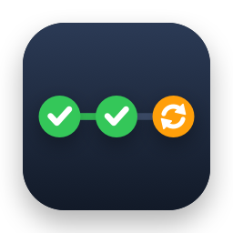
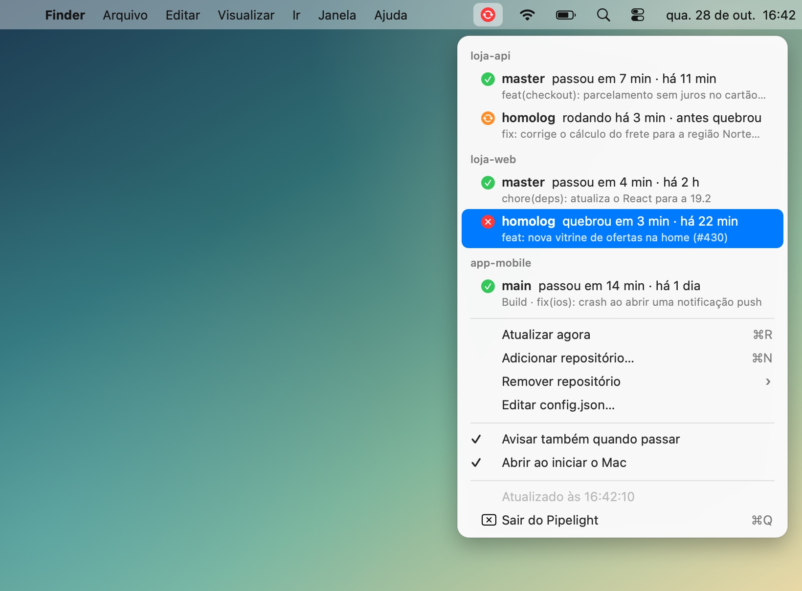

<div align="center">



# Pipelight

**O CI/CD dos seus repositórios do GitHub na barra de menus do Mac. Bate o olho e você sabe se está rodando, se passou ou se quebrou, sem ficar abrindo a aba Actions.**

[](https://github.com/victorreinor/pipelight/releases/latest)
[](#instalar)
[](#instalar)
[](Package.swift)
[](https://cli.github.com)
[](LICENSE)



</div>

## Instalar

O Pipelight conversa com o GitHub pelo [GitHub CLI](https://cli.github.com) (`gh`), usando o login que você já tem. Se ainda não tem o `gh`:

```sh
brew install gh && gh auth login
```

Depois, abra o **Terminal** (⌘ Espaço → digite `Terminal` → Enter), cole a linha abaixo e aperte Enter:

```sh
curl -fsSL https://raw.githubusercontent.com/victorreinor/pipelight/main/install.sh | bash
```

Pronto: o ícone do Pipelight aparece na barra de menus, perto do relógio. Clique nele e escolha **Adicionar repositório…**. Na primeira vez, o macOS pergunta se o Pipelight pode mandar notificações: diga que sim.

> Precisa de macOS 14 (Sonoma) ou mais novo, em Mac com Apple Silicon ou Intel. O mesmo comando também **atualiza** para a última versão, e seus repositórios continuam configurados. Quer saber o que ele faz antes de rodar? Leia o [`install.sh`](install.sh): são poucas linhas.

<details>
<summary><b>Prefere baixar o .zip?</b></summary>

1. Baixe o `Pipelight.zip` da [última versão](https://github.com/victorreinor/pipelight/releases/latest).
2. Dê dois cliques para descompactar e arraste o `Pipelight.app` para **Aplicativos**.
3. Na primeira vez, o macOS avisa que não pode verificar o desenvolvedor. Vá em **Ajustes do Sistema › Privacidade e Segurança**, role até o fim e clique em **Abrir Mesmo Assim** ([passo a passo da Apple](https://support.apple.com/guide/mac-help/open-a-mac-app-from-an-unknown-developer-mh40616/mac)).
   Ou, no Terminal: `xattr -dr com.apple.quarantine /Applications/Pipelight.app`

</details>

<details>
<summary><b>Quer compilar do código-fonte?</b></summary>

Basta ter as Command Line Tools da Apple (não precisa do Xcode):

```sh
xcode-select --install          # só na primeira vez
git clone https://github.com/victorreinor/pipelight.git
cd pipelight
./scripts/install-dev.sh
```

</details>

<details>
<summary><b>Por que o macOS reclama do app baixado manualmente?</b></summary>

O Pipelight é de código aberto, mas não é "notarizado" pela Apple. Isso exige uma conta paga de desenvolvedor (US$ 99/ano). O macOS bloqueia apps não notarizados que chegam pelo navegador. O instalador pelo Terminal não esbarra nisso, e o caminho manual pede só a liberação uma vez nos Ajustes.

</details>

## O que ele faz

### Um ícone que resume tudo


| Ícone | Quer dizer |
| --- | --- |
| 🟢 check | Todos os branches passaram |
| 🟠 girando | Tem esteira rodando (ou na fila, ou esperando aprovação) |
| 🔴 girando | Tem esteira rodando **e** algum outro branch está quebrado |
| 🔴 X | Algum branch quebrou |

### Um menu com cada branch

Clique no ícone e veja cada repositório com seus branches: o que aconteceu (`passou em 6 min · há 12 min`, `rodando há 3 min · antes quebrou`, `quebrou em 4 min · há 20 min`) e, embaixo, o título do commit. **Clicar num branch abre a execução no GitHub.**

### Notificações quando termina

- **❌ quebrou**, com som, para você não deixar passar.
- **✅ voltou a passar**, quando o branch estava quebrado e o conserto passou.
- **✅ passou**, sem som. Dá para desligar em **Avisar também quando passar**.

Clicar na notificação abre a execução no GitHub. Resultados antigos não viram notificação: o Pipelight só avisa o que terminar depois que ele abriu.

E mais:
- **Abre junto com o Mac** (dá para desligar no menu).
- **Sem token para configurar:** usa o login do `gh`, que fica no Chaveiro do macOS.
- **Leve:** app nativo (Swift + AppKit), sem Electron, sem navegador embutido e sem ícone no Dock.

## Escolher os repositórios

Pelo menu, em **Adicionar repositório…**:

| Campo | O que pôr |
| --- | --- |
| Repositório | `dono/nome`, ou cole o endereço do GitHub (qualquer página do repo serve) |
| Branches | Separados por vírgula, como `master, homolog`. Vazio = o branch padrão do repo |
| Workflow | O nome do workflow da esteira, como `CI`. Vazio = todos os workflows do branch |

> **Dica:** preencha o workflow. Repositórios costumam ter vários (CodeQL, Dependabot, revisão do Copilot…), e sem filtro o Pipelight considera todos. Para ver os nomes: `gh workflow list -R dono/nome`.

Para remover, use **Remover repositório ›**. Também dá para editar tudo à mão em **Editar config.json…** (`~/Library/Application Support/Pipelight/config.json`). O Pipelight relê o arquivo sozinho quando ele muda:

```json
{
  "repos" : [
    {
      "branches" : ["master", "homolog"],
      "repo" : "minha-empresa/api",
      "workflow" : "Continuous integration"
    },
    {
      "branches" : ["main"],
      "repo" : "minha-empresa/app"
    }
  ]
}
```

## Como ele funciona

Para cada branch, o Pipelight roda `gh run list --repo dono/nome --branch X --workflow Y --json …`:

- **A cada 30 s**, e **a cada 15 s enquanto alguma coisa roda**, para você saber logo que terminou. Também atualiza ao abrir o menu e quando o Mac acorda.
- Com muitos branches, o intervalo aumenta sozinho para ficar abaixo de ~2000 requisições por hora. O GitHub dá 5000 por hora a cada login, e o resto do seu uso do `gh` também conta.
- O status de um branch é a última execução de cada workflow. Se algum está rodando, ele aparece; senão, aparece o que quebrou; senão, o mais recente.
- Nada sai do seu Mac além das chamadas que o próprio `gh` faz ao GitHub.

## Problemas comuns

| Aparece no menu | O que fazer |
| --- | --- |
| `gh não encontrado` | `brew install gh` e depois `gh auth login` |
| `gh sem login` | `gh auth login` no Terminal |
| `repositório não encontrado (ou sem acesso)` | Confira o nome. Se a organização usa SSO, autorize o login do `gh` nela: `gh auth refresh -h github.com` |
| `workflow não encontrado nesse repositório` | Veja os nomes com `gh workflow list -R dono/nome` |
| `sem conexão com o GitHub` | O Pipelight tenta de novo sozinho; o último status conhecido continua na tela |
| **Ativar notificações…** | As notificações estão desligadas: o item abre direto o lugar certo nos Ajustes |

## Desinstalar

```sh
pkill -x Pipelight; rm -rf /Applications/Pipelight.app ~/Applications/Pipelight.app
```

Para apagar a lista de repositórios também: `rm -rf ~/Library/Application\ Support/Pipelight`. Se o Pipelight continuar listado em **Ajustes do Sistema › Geral › Itens de Início**, é só remover de lá.

## Desenvolvimento

```sh
./scripts/test.sh                                   # testes da lógica (status, notificações, config, textos)
./scripts/install-dev.sh                            # compila e instala sua versão local
./scripts/screenshots.sh                            # regenera as imagens deste README
PIPELIGHT_PRINT_MENU=1 /Applications/Pipelight.app/Contents/MacOS/Pipelight   # imprime o menu com os dados reais
```

Para publicar uma versão nova no GitHub Releases, rode `./scripts/release.sh`. A versão sai sozinha da última tag: por padrão sobe o último número (0.1.0 → 0.1.1), e `[minor]` ou `[major]` no título de um commit sobe mais.

- `Sources/PipelightCore`: modelos, regras de status e de notificação, config e textos (puros e testados)
- `Sources/Pipelight`: o app AppKit (barra de menus, menu, gh, notificações, login item)

Vai mexer no código, com ou sem IA? Comece pelo [CLAUDE.md](CLAUDE.md) (mapa do código, decisões e armadilhas) e pelo [docs/ARCHITECTURE.md](docs/ARCHITECTURE.md).

## Licença

[MIT](LICENSE) © Victor Reinor
